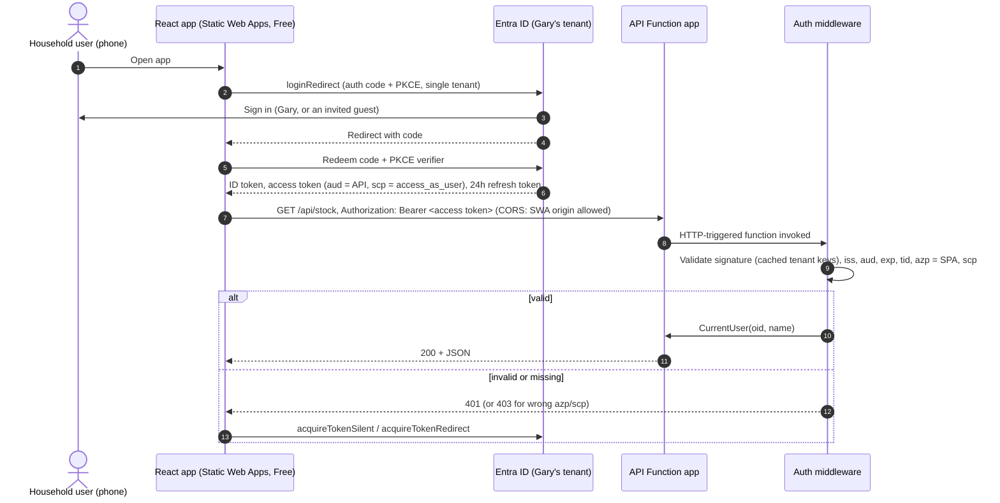

# Spike #35: Entra ID sign-in for the React app and API Function

Card: https://trello.com/c/lFc5tXyq

## Question

What is the simplest robust way for the React app (Azure Static Web Apps, **free tier**) to sign household users in with **Entra ID** and call the API Function app with a **bearer token**?

## Summary

- **No linked backend on the Free plan** (confirmed). The React app calls the API Function app's own hostname directly, and the Function app allows the Static Web App's origin through CORS.
- **Sign-in with MSAL React** (authorization code + PKCE), not Static Web Apps' built-in auth. The built-in Entra provider on the Free plan lets *any* Microsoft account sign in and gives the browser no access token for our API.
- **Validate the token in our own code** in the API Function app (a small worker middleware using Microsoft's `Microsoft.IdentityModel` libraries), not App Service built-in auth ("Easy Auth"). Easy Auth's support on Flex Consumption is unclear, and code validation behaves the same locally and in Azure and is unit-testable.
- **Two single-tenant app registrations** in Gary's own Entra tenant: an **API** registration exposing `access_as_user` that pre-authorises the **SPA** registration, which has SPA redirect URIs for localhost and the Static Web App.
- **Only invited people can sign in:** the registrations are single-tenant, household members are **invited as guests**, and the API also checks the tenant and calling app.
- **Registrations as code** with the **Microsoft Graph Bicep extension** (GA since August 2025), deployed by `deploy/infra.sh`.
- **Everything here is free.**

## 1. Linked backends on the Free plan

Not available. The Static Web Apps plan comparison lists "APIs via Azure Functions" as **Managed** only on Free, and **"Managed or Bring your own Functions app"** on Standard. Managed functions are HTTP-only, and our API app also hosts the change-feed processor and timers, so it must be a separate Function app.

**So:** the React app calls `https://<api-app>.azurewebsites.net/api/...` directly, with `Authorization: Bearer <token>`.

**CORS** is set on the Function app (platform CORS, `siteConfig.cors.allowedOrigins` in Bicep) to the Static Web App's origin, plus any custom domain later. No `supportCredentials`: the token travels in a header, not a cookie. Localhost isn't needed in Azure, because local development runs the API locally too (see [Local development](#local-development)).

## 2. Sign-in in the SPA: MSAL React

| | Static Web Apps built-in auth (Free) | **MSAL React** |
|---|---|---|
| Restrict to our tenant | No. "The preconfigured Microsoft Entra ID provider allows any Microsoft account to sign in." Restricting it needs a custom provider, which is **Standard plan only**. | Yes: single-tenant authority |
| Access token for our API | No. The built-in auth gives a session cookie and `/.auth/me` (a client principal), not a token for another API. | Yes: `acquireTokenSilent` with our API's scope |
| Works on the Free plan | Yes | Yes (it's just JavaScript) |

**Recommendation: `@azure/msal-browser` + `@azure/msal-react`**, authorization code flow with PKCE (MSAL's default for SPAs).

- **Authority:** `https://login.microsoftonline.com/<tenantId>` (single tenant).
- **Scope:** `api://<tenantId>/cupboard-tracker-api/access_as_user`.
- **Redirect flow** (`loginRedirect`, `acquireTokenRedirect`), not pop-ups: it's phone-first, and pop-ups are awkward on mobile browsers.
- **Token calls:** `acquireTokenSilent` before each API call (MSAL caches and refreshes). On `InteractionRequiredAuthError`, fall back to `acquireTokenRedirect`.
- **Cache:** `localStorage`, so reopening the app on the phone doesn't mean signing in again. The trade-off is that a cross-site scripting bug could read tokens. Keep a strict Content Security Policy in `staticwebapp.config.json`, and never render HTML from untrusted data (Open Food Facts names).
- **Expect a re-sign-in roughly daily.** SPA refresh tokens last **24 hours, fixed** ("a non-adjustable, non-sliding window"). After that, MSAL tries a hidden iframe, which usually fails on phones because third-party cookies are blocked, so it redirects. If Gary ticked "Stay signed in", the redirect normally passes straight through without a password. That's acceptable for a household app.
- **Config is not secret:** client ID, tenant ID, API scope and API base URL are build-time values (`VITE_…`), filled in by the UI deploy script from Bicep outputs.

## 3. Token validation in the API: in code, not Easy Auth

| | Easy Auth on the Function app | **Validate in code (worker middleware)** |
|---|---|---|
| Works on Flex Consumption | **Unclear.** A Microsoft Q&A answer in July 2024 said, per the product team, it wasn't enabled on Flex Consumption. A 2025 Q&A post shows it working after excluding `/admin/*`. The current Flex Consumption docs don't mention it either way. | Yes. It's our code. |
| Local development | Doesn't run under `func start`, so local behaviour differs (no auth, or faked headers) | Identical locally and in Azure |
| Unit testing | Only the header-reading part | The validator and the middleware are both testable |
| Per-route exceptions | `excludedPaths` in config (needed for function-key routes such as #48's `/api/diagnostics/test-error` and the `/admin` endpoints) | Explicit in code: only functions that need a user are checked |
| Code to write | Almost none | A small middleware (~100 lines) |

**Recommendation: validate the token in code.**

- **Where:** an `IFunctionsWorkerMiddleware` in the API Function app (the host, which is the adapter layer). It runs for HTTP-triggered functions that need a user, and lets the others (function-key or timer functions) through. Those HTTP functions use `AuthorizationLevel.Anonymous`, because the middleware does the auth.
- **How:** `Microsoft.IdentityModel.JsonWebTokens.JsonWebTokenHandler`, with signing keys from the tenant's OpenID configuration (`https://login.microsoftonline.com/<tenantId>/v2.0/.well-known/openid-configuration`), fetched and cached by `ConfigurationManager<OpenIdConnectConfiguration>`. These are Microsoft's own libraries, the same ones Microsoft.Identity.Web uses underneath.
- **Checks:**
  - signature, `exp` / `nbf`;
  - `iss` = `https://login.microsoftonline.com/<tenantId>/v2.0` (v2 tokens: the API registration sets `requestedAccessTokenVersion: 2`);
  - `aud` = the API registration's client ID;
  - `tid` = our tenant;
  - `azp` = the SPA registration's client ID (only our app can call);
  - `scp` contains `access_as_user`.
  - Missing or invalid token → **401**. Valid token with the wrong `azp` or `scp` → **403**.
- **What Application sees:** an `ICurrentUser` (or a `CurrentUser` record passed in) with `ObjectId` (`oid`, used for `namedBy` / `checkedOutBy`) and `DisplayName` (`name`). No JWT types reach Application or Domain.
- The **ingest** Function app keeps function-key auth and isn't affected.
- The SignalR negotiate endpoint (spike #38) uses the same middleware.

## 4. App registrations

Both are **single-tenant** (`signInAudience: AzureADMyOrg`) in Gary's tenant.

**API: `cupboard-tracker-api`**
- Application ID URI: `api://<tenantId>/cupboard-tracker-api`. This format is accepted without a verified domain, and it avoids the chicken-and-egg problem of `api://<own appId>` in Bicep.
- Exposes one delegated scope, **`access_as_user`** ("Access Cupboard Tracker as you"). Its scope ID is a fixed GUID from `guid()` in Bicep.
- **`preAuthorizedApplications`**: the SPA's client ID for that scope, so users never see a consent prompt.
- `requestedAccessTokenVersion: 2`.
- No secret, no redirect URIs.

**SPA: `cupboard-tracker-spa`**
- Platform **Single-page application**, with redirect URIs:
  - `http://localhost:5173/` (Vite's default dev port)
  - `https://<static-web-app-default-hostname>/`
  - any custom domain later.
- No secret, no implicit grant.
- It doesn't need `requiredResourceAccess` for the API: MSAL asks for the scope at runtime, and pre-authorisation covers consent. Leaving it out also avoids a circular dependency (the API references the SPA, but not the other way round).

Each gets a **service principal** (enterprise app).

## 5. Restricting access

- **Tenant:** Gary's existing Entra tenant (the directory behind his Azure subscription). No separate or "external" tenant: an External ID tenant is meant for consumer sign-up and is more than we need.
- **Who can sign in:** single-tenant means only **users in that tenant**: Gary, plus household members Gary **invites as guests** (Entra admin center → Users → Invite external user). Guests sign in with their own Microsoft account, or with a one-time passcode emailed to them if they don't have one. **Removing someone = deleting the guest.**
- **Belt and braces:** turn on **"Assignment required"** on the SPA's enterprise app (`appRoleAssignmentRequired: true` on its service principal) and assign each household user **directly**. Assigning a **group** needs Entra ID P1, so use direct assignment. *Check during the registrations task that assignment works on the free tier; if it doesn't, the tenant boundary above is still the control.*
- **In the API:** the `tid` and `azp` checks mean a token for some other app, or from another tenant, is rejected even if it's otherwise valid.
- Make sure nobody else is in the tenant who shouldn't use the app. *Gary to confirm.*

## 6. Registrations as code: Microsoft Graph Bicep extension

- **Recommended:** the **Microsoft Graph Bicep extension** (`extension microsoftGraphV1` in Bicep, configured in `bicepconfig.json`). It's GA (Microsoft identity blog, August 2025) and supports `Microsoft.Graph/applications` and `Microsoft.Graph/servicePrincipals`. Each app needs a stable `uniqueName`, so redeploys update rather than duplicate.
- Put it in `infra/` as an `entra.bicep` module, deployed by `deploy/infra.sh` with everything else. It outputs the client IDs, tenant ID and scope for the UI deploy and the API's app settings.
- **Order:** the Static Web App before the SPA registration (it needs the hostname); the SPA registration before the API registration (pre-authorisation needs the SPA's client ID).
- **Permissions:** whoever runs the deployment needs to be able to create app registrations (Application Administrator, or Global Administrator, which Gary is in his own tenant).
- **To check during the registrations task:** Graph Bicep's reference pages say *personal Microsoft accounts* aren't supported for some resources. If Gary's admin account is a personal Microsoft account (e.g. a Gmail-backed one) and the deployment fails, the fallbacks are: (a) create a cloud-only admin user in the tenant for deployments, or (b) an idempotent `az ad app` script in `deploy/`.
- Assigning users to the app ("Assignment required") stays a manual step, done in the Entra admin center when someone is invited.

## 7. Cost

| Item | Cost |
|---|---|
| Static Web Apps Free plan | Free ("For personal projects") |
| Entra ID (Free), app registrations, direct user assignment | Free |
| Guest users | Free up to 50,000 monthly active users |
| MSAL, `Microsoft.IdentityModel` | Free (open source) |
| Graph Bicep extension | Free |

Nothing here needs a paid tier. Group-based app assignment (P1) and custom auth providers on Static Web Apps (Standard) are avoided on purpose.

## Recommended design

## Local development

- **UI:** `npm run dev` on `http://localhost:5173`. Sign in for real against Entra (the localhost redirect URI is registered). A `.env.local` (git-ignored) holds the non-secret client ID, tenant ID and scope, plus `VITE_API_BASE_URL=http://localhost:7071`.
- **API:** `func start` on `http://localhost:7071`. The middleware validates the same real tokens as in Azure. `local.settings.json` (git-ignored) holds the tenant ID and the two client IDs, plus `Host.CORS = http://localhost:5173`.
- No auth bypass in the API: local behaves like production.
- **Unit tests** need no network or Entra:
  - **Validator:** generate an RSA key in the test, sign tokens with it, and feed the validator a static signing-key configuration. Cover a good token, expired, wrong `aud` / `iss` / `tid` / `azp`, missing `scp`, and a bad signature.
  - **Middleware:** a fake validator. Cover 401 without a header, 403 on scope, and `CurrentUser` set on success. Functions without auth are left alone.
  - **Use cases:** take a fake `CurrentUser`.

## Recommendation

1. **UI:** MSAL React, auth code + PKCE, redirect flow, single-tenant authority, `localStorage` cache, `acquireTokenSilent` → redirect fallback. Call the API Function app directly; CORS allows the Static Web App origin.
2. **API:** validate bearer tokens in a worker middleware (`Microsoft.IdentityModel`), checking signature, issuer, audience, tenant, `azp` and `scp`. Expose `CurrentUser` to Application. Don't use Easy Auth.
3. **Registrations:** single-tenant API (`access_as_user`, pre-authorising the SPA, v2 tokens) and SPA (SPA redirect URIs), as code with the Graph Bicep extension in `infra/`.
4. **Access:** Gary's tenant only; invite household members as guests; "Assignment required" with direct user assignment if available on the free tier.
5. **Cost:** free.

## Decisions for Gary

1. Is the Entra tenant behind your Azure subscription OK to hold the app registrations and the household guests? Is anyone in it who shouldn't use the app?
2. Is your Azure admin account a **personal Microsoft account** (e.g. signed up with Gmail) or a user created in the tenant? That decides whether the Graph Bicep deployment can run as you, or needs a cloud-only admin user.
3. Is roughly-daily re-sign-in (usually without a password, if you tick "Stay signed in") acceptable on the phone?

## Suggested follow-up cards (not created)

- **Notes for [Task] Entra ID app registrations** (no new card): build the two registrations above in `infra/entra.bicep` with the Graph extension, in the order given. Test "Assignment required" on the free tier and the deploy as Gary's account type, and record the fallback used, if any.
- **Notes for [Task] React UI skeleton** (no new card): MSAL React set up as above, the `VITE_…` config from Bicep outputs, and a strict Content Security Policy in `staticwebapp.config.json`.
- **[Task] API bearer-token validation middleware:** the middleware, validator, `CurrentUser`, CORS in Bicep, and the tests listed above. It could be part of the first API feature ([Feature] Stock list on the phone) instead of a card of its own.

## Sources

- Static Web Apps plans (Free: managed functions only; custom auth providers Standard only): https://learn.microsoft.com/en-us/azure/static-web-apps/plans
- Static Web Apps authentication (preconfigured Entra provider allows any Microsoft account; restricting needs a custom provider): https://learn.microsoft.com/en-us/azure/static-web-apps/authentication-authorization
- Flex Consumption plan (considerations; no mention of built-in auth): https://learn.microsoft.com/en-us/azure/azure-functions/flex-consumption-plan
- Easy Auth on Flex Consumption: July 2024 Q&A (not enabled): https://learn.microsoft.com/en-us/answers/questions/2140342/azure-functions-flex-consumption-plan-authenticati ; 2025 Q&A (working with `/admin/*` excluded): https://learn.microsoft.com/en-us/answers/a/1897287
- App Service / Functions Entra auth (allowed audiences, `allowedApplications`, `x-ms-client-principal`, 401 for APIs): https://learn.microsoft.com/en-us/azure/app-service/configure-authentication-provider-aad
- MSAL.js token lifetimes (SPA refresh tokens 24 hours, non-sliding; iframe renewal fails with third-party cookies blocked): https://learn.microsoft.com/en-us/entra/msal/javascript/browser/token-lifetimes
- Refresh token lifetimes: https://learn.microsoft.com/en-us/entra/identity-platform/refresh-tokens
- Group-based app assignment needs P1/P2: https://learn.microsoft.com/en-us/entra/identity/users/groups-saasapps
- External ID pricing (guests free up to 50,000 MAU): https://learn.microsoft.com/en-us/entra/external-id/external-identities-pricing
- Graph Bicep templates GA: https://devblogs.microsoft.com/identity/bicep-templates-for-microsoft-entra-id-resources-is-ga/ ; reference (e.g. oauth2PermissionGrants, account-type support): https://learn.microsoft.com/en-us/graph/templates/reference/oauth2permissiongrants?view=graph-bicep-1.0
